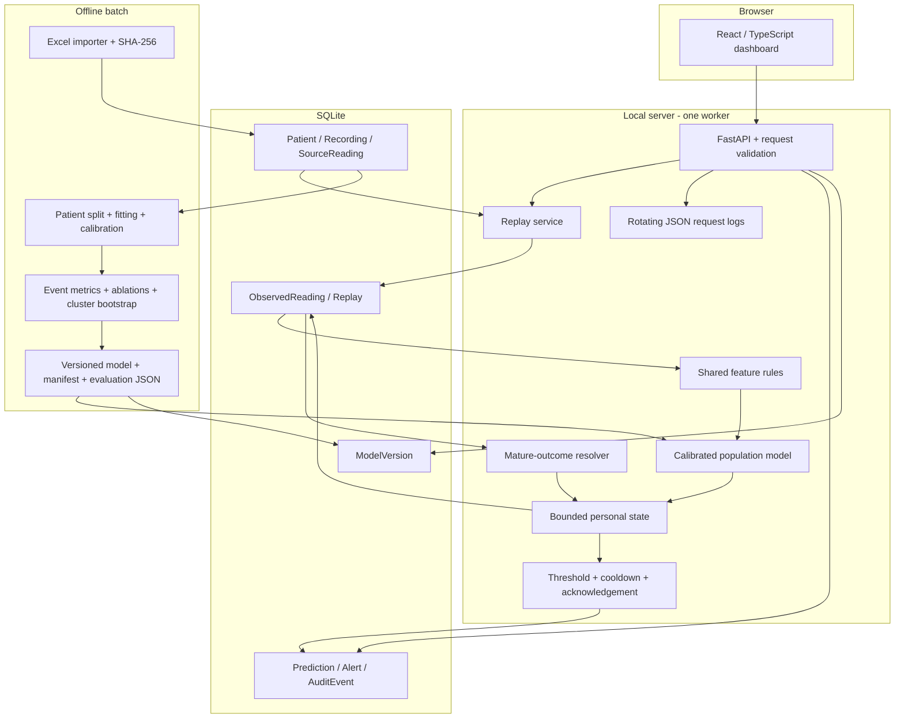
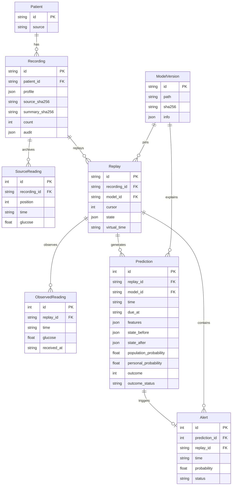
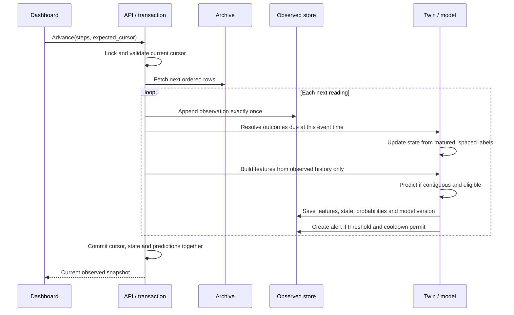

# Architecture and engineering decisions

## High-level design

GlycoAhead is a modular monolith: one FastAPI process serves both the built React frontend and the API. SQLite is sufficient for one developer and a local replay. Training is a separate CLI process. No Redis, Celery, Kafka, Kubernetes, vector database, RAG or paid cloud dependency is needed.



## Source code map

```text
backend/glycoahead/
  config.py       Project paths and environment configuration
  db.py           SQLAlchemy schema, connection and migration entry point
  ingestion.py    File validation, canonical readings and provenance
  domain.py       Pure chronology, endpoint, features and twin rules
  ml.py           Calibrated model and checksum-verified bundle loading
  training.py     Patient splits, fitting, calibration, artifact creation
  evaluation.py   Sequential adaptation, alerts, metrics and uncertainty
  service.py      Transactional replay and prediction lifecycle
  api.py          Validated endpoints, logs, static UI and health
  cli.py          Initialization, import, training and local server
frontend/src/     React application, API client and TypeScript contracts
migrations/      Frozen initial schema (SQLite) and Alembic environment
scripts/         Windows setup and startup
docs/            Brief, model card, architecture and operating guide
data/            Local database (ignored by Git)
artifacts/       Frozen models and reports (ignored by Git)
logs/            Rotating local logs (ignored by Git)
```

## Database relationships



AuditEvent is an append-only application log of imports, model registration, replay creation, gap resets and alert acknowledgement. No patient names, emails or identifiers from clinical care are collected.

Features and state snapshots are stored on Prediction instead of separate entities. Replay owns its current state; this prevents one demonstration contaminating another. Confirmed onset markers are recomputed from observed readings using the versioned endpoint rule. Evaluation reports live with immutable model versions instead of a separate evaluation table.

Uniqueness constraints prevent duplicate source positions, source timestamps, observed timestamps, prediction timestamps within a replay and duplicate alerts for one prediction. Foreign keys enforce linkage; replay/source foreign keys are indexed. Glucose is always mg/dL. Sensor times retain explicit +08:00 offsets; system receipt/audit times use UTC.

## One reading through the system



An optimistic cursor rejects stale/retried advance requests with HTTP 409; clients refresh rather than replaying a batch twice. A process lock serializes mutations. This is intentionally a **one-worker** application. A crash before commit rolls back the batch; a successful commit is durable in SQLite's write-ahead log.

Event time is when the sensor measurement occurred; processing time is when the application handles it. Accelerated replay never changes the event-time horizon. A paused historical replay does not become stale merely because wall-clock time passes. The outage control advances virtual time, omits readings during the simulated disconnection, censors incomplete outcomes, then resets state on the next gap. It requires 13 contiguous readings before new predictions resume.

## API contract

The generated OpenAPI reference at `/docs` is authoritative for validation.

- `GET /api/health`: database/model readiness; returns 503 if setup is incomplete.
- `GET /api/recordings`: linked cohort metadata; no future glucose values.
- `POST /api/replays`: body `{"recording_id":"2000_0_20201230"}`. Creates an isolated session, pins model version and returns a snapshot.
- `POST /api/replays/{id}/advance`: body `{"steps":1,"expected_cursor":13}`. Steps must be 1–96.
- `GET /api/replays/{id}`: observed history, present prediction, state, alerts and source provenance.
- `POST /api/replays/{id}/simulate-disconnect`: body `{"minutes":45}`. Simulation only; not device integration.
- `POST /api/alerts/{id}/acknowledge`: idempotently marks an alert reviewed.
- `GET /api/predictions/{id}`: exact stored feature/state/model evidence.
- `GET /api/replays/{id}/export`: downloadable JSON snapshot.
- `GET /api/evaluation`: aggregate report for the active model.
- `GET /api/audit`: latest 100 audit records.

Unknown objects return 404, validation failures 422, concurrent/stale replay commands 409, oversized requests 413, cross-origin mutations 403, and setup failures 503. Raw exceptions are not returned to the browser.

## Prediction reconstruction

Use the Prediction's model ID to locate ModelVersion and verify its SHA-256. Supply the saved feature values in the artifact's feature-column order. Run the frozen estimator and sigmoid calibrator, then apply the saved state bias only if the saved cold-start conditions permit. Use the model's activation flag to determine whether the alert used population or personal probability. The recording and summary hashes identify original inputs. Never reconstruct a past prediction using today's latest patient state or model.

## Architecture decision records

**ADR 001 — Modular monolith.** Separate modules provide boundaries without managing a distributed system. Training is a batch command because it is slower and has access to labelled future data; inference is isolated from that path.

**ADR 002 — SQLite.** One local operator and modest records justify transactional SQLite. PostgreSQL becomes appropriate for multiple users, concurrent ingestion or remote deployment. Do not run multiple API workers against this replay locking design.

**ADR 003 — React over Streamlit.** A small typed interface demonstrates frontend/API integration, explicit loading states and durable server-side replay. FastAPI serves the compiled assets, so inference needs one local process.

**ADR 004 — Bounded adaptation.** The twin is a small learned predictive state, not a claimed physiological replica. Its bias is capped at ±0.75 log-odds. Learning anchors are separated by the horizon plus confirmation interval; highly overlapping outcomes cannot each count as new evidence. No separate per-patient neural network is trained.

**ADR 005 — Provenance over infrastructure breadth.** Exact model hashes, inputs, state and outcomes provide useful traceability. Redis, queues, Kubernetes, cloud GPUs, LLMs and MLflow would add operations work without a present requirement.

**ADR 006 — No public service yet.** Bind to loopback. A publicly reachable system needs authentication, authorization, rate limiting, HTTPS, stronger upload/retention policy and a reviewed threat model. Docker files are packaging, not proof of production readiness.

## Documentation sources

- Competition: https://unstop.com/hackathons/crp-digital-twin-challenge-2026-happiest-health-1757873/amp
- Dataset paper: https://www.nature.com/articles/s41597-023-01940-7
- FastAPI static hosting: https://fastapi.tiangolo.com/tutorial/static-files/
- scikit-learn calibration: https://scikit-learn.org/stable/modules/calibration.html

Local implementation choices are design decisions, not competition mandates or medical guidance.
