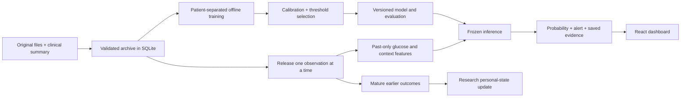

# GlycoAhead

## Submission details

- **Project title:** GlycoAhead.
- **Participant:** Surajkumar Reddiar.
- **Team:** Individual entry; one member.
- **College:** Rajiv Gandhi Institute of Technology.
- **Responsibilities:** Data processing, feature engineering, ML training/evaluation, backend, database, frontend integration and project documentation.
- **Challenge:** Happiest Health Digital Twin Challenge 2026.

### Submission files and video

- [Architecture diagram (PDF)](docs/submission/GlycoAhead-Architecture.pdf) — runtime design, training/inference paths, database relationships and chronology safeguards.
- [Project presentation (PDF)](docs/submission/GlycoAhead-Presentation.pdf) — 15 slides covering the problem, dataset, healthcare use case, technical design, models, measured results and future scope.
- **15–20 minute demonstration video:** https://www.youtube.com/watch?v=0glDS7WuIog
- [Submission checklist](docs/SUBMISSION_CHECKLIST.md).
- [Open-source code license: MIT](LICENSE).
- [Dataset and nutrition attribution](DATA_SOURCES.md).

**Publication status:** This package is prepared for GitHub upload. A public repository URL and signed-out access to the repository, PDFs and video have not yet been verified. Do not submit until the video link is present and these access checks are complete.

## Problem statement

For adults with Type 2 diabetes using continuous glucose monitoring, combine linked historical information and the preceding three hours of glucose observations with available meal/medication context to estimate whether a new sustained high-glucose episode will begin within 60 minutes. Maintain an evolving patient-specific predictive state while preventing future observations from entering the current prediction.

## Healthcare use case

A clinician or researcher reviews a patient's recorded glucose timeline, receives threshold-based warnings and inspects the history and context behind each prediction. Earlier warning may support earlier review; improved patient outcomes have not been demonstrated. The current application replays anonymized recordings and does not prescribe medication, diagnose emergencies or connect to a live wearable.

## Technical stack and AI/ML framework

- **Frontend:** React, TypeScript, Vite and Recharts.
- **Backend and API:** Python and FastAPI.
- **Database:** SQLite with SQLAlchemy and Alembic migrations.
- **Data processing:** pandas and NumPy.
- **AI/ML:** scikit-learn histogram gradient boosting, median imputation and separate sigmoid probability calibration; logistic regression provides the simple glucose/trend baseline.
- **Model lifecycle:** Joblib artifacts, SHA-256 checksums, a model registry, frozen nutrition catalogs and patient-separated evaluation.
- **Build and operations:** Local startup scripts, existing tests, GitHub Actions workflow and optional Docker configuration. Docker deployment and GitHub-hosted CI execution are not claimed as completed.

There is no LLM or RAG dependency in glucose prediction. The personal-state mechanism is a bounded outcome-based adjustment, not reinforcement learning; it is disabled for deployed alerts pending evidence of benefit.

## Product overview

**A working research application for forecasting sustained high-glucose episodes in Type 2 diabetes.**

GlycoAhead combines patient history, three hours of continuous glucose monitor (CGM) readings, timestamped food and medication records, and estimated nutrients. It provides chronological patient replay, calibrated risk estimates, alerts, saved prediction evidence and reproducible model comparisons.

This is recorded-data replay, not a live wearable integration or a clinically validated treatment system. Personal adaptation is implemented as a research candidate; the deployed alerts use the calibrated population model.

## What you can inspect

- **Patient workspace:** replay sensor readings, inspect probability, food/medication context, stale-data states and alerts.
- **Patient cohort:** browse linked recordings and patient history.
- **Model evidence:** distinguish the deployed model's evaluation from three-run comparisons, calibration and limitations.
- **Food reference:** inspect the existing nutrition catalog and its source metadata.
- **API:** OpenAPI at `/docs`, saved feature/state snapshots at `/api/predictions/{id}`.

Stack: Python, FastAPI, pandas/NumPy, scikit-learn, SQLAlchemy, SQLite/Alembic, React/TypeScript and Vite. Training is a separate CLI job; the local web app uses one backend process. No paid cloud service or GPU is required.

## Results and selected model — 20 October 2026

Across three predefined patient assignments, independently tuned models achieved **80.60% mean episode recall**, **1.08 mean false alerts per patient-day** and **26.48 minutes mean warning among caught episodes**. Original settings achieved 79.49%, 1.10/day and 27.05 minutes respectively. These are unweighted means of three run results, not classification accuracy or independent replications.

The packaged model is the training-only tuning winner for the original seed-2026 group. On its 20 evaluation patients it caught **243 of 294 eligible episodes (82.65%)**, with **1.39 false alerts/day**, **30-minute median warning** and **27.78-minute mean warning**. Its threshold-selection group of 10 patients had 88.57% recall and 0.96 false alerts/day. Do not confuse these evaluation groups or describe the three-run average as this single model's score.

Settings: histogram gradient boosting, learning rate **0.05**, **140** iterations, **15** leaves, minimum **80** samples/leaf, L2 **10**, early stopping disabled and random seed **2026**. Separate sigmoid calibration is retained. Alerts require probability **>=32%**, eligibility and no prior alert in the **75-minute cooldown**.

The simple glucose/trend baseline averaged **81.06% recall**, **1.17 false alerts/day** and **24.67-minute mean warning**. Tuning brings a modest tradeoff, not universal superiority. The selected model misses the proposed <=1 false alert/day target on evaluation patients. The cohort was previously inspected: all these results are **internal robustness evidence**, not new external clinical validation. See [model card](docs/MODEL_CARD.md), [tuning](docs/TUNING.md) and the exact aggregate JSON in `release/selected_model/comparison.json` in the upload package.

### Tuned meal-feature comparisons

The Model evidence page now shows the tuned current model, tuned meal-timing model, tuned pre-meal-glucose model and simple baseline. The original rows are replaced in the display; their results remain in the full report.

After the same training-only search, meal timing averages **81.94% recall / 1.09 false alerts per day / 26.83-minute mean warning**. Pre-meal glucose averages **79.84% / 1.01 per day / 26.51 minutes**. Meal timing trades more false alerts for higher recall. The active replay model remains the selected 54-feature current model. These are internal comparison results, not new clinical validation.

## Run from the GitHub upload package

Use Python 3.12 and Node.js 24. Initial dependency installation needs internet access. Once installed, the app runs offline.

1. Download the [Shanghai release, version 5](https://figshare.com/articles/dataset/diabetes_datasets_zip/21600933/5) separately. Extract it so one folder contains `Shanghai_T2DM/` and `Shanghai_T2DM_Summary.xlsx`.
2. Open PowerShell in the extracted project root and run:

```powershell
.\scripts\setup.ps1 -DatasetPath "D:\diabetes_datasets"
.\scripts\start.ps1
```

Replace the example dataset path with your own. Setup creates a virtual environment, imports the original recordings, installs the selected model and its unchanged nutrition catalog, and builds the frontend. It **does not retrain** or silently replace the model with a glucose-only model.

Open **http://127.0.0.1:8000**. Stop with Ctrl+C. Subsequent starts need only `scripts/start.ps1` or `Start-GlycoAhead.cmd`.

### Manual setup (cross-platform)

```bash
python -m venv .venv
# Activate .venv using the command appropriate for your shell.
python -m pip install -r requirements.lock.txt
python -m pip install --no-deps -e .
python -m glycoahead.cli import-shanghai /path/to/diabetes_datasets
python -m glycoahead.cli install-model release/selected_model
cd frontend
npm ci
npm run build
cd ..
python -m glycoahead.cli serve
```

On Windows activation is `.\.venv\Scripts\Activate.ps1`; on Linux/macOS it is `source .venv/bin/activate`. Set `OMP_NUM_THREADS=4`, `OPENBLAS_NUM_THREADS=4` and `MKL_NUM_THREADS=4` in your shell to limit CPU parallelism for training/inference. Install only trusted joblib files; checksums do not make an untrusted pickle safe.

The original development workspace already has its database, models and frontend. It can continue using `scripts/start.ps1`. New replays use the new model; earlier saved replays keep their original model version.

## Exactly what is predicted

An eligible new episode has two consecutive 15-minute readings strictly above 180 mg/dL, preceded by two readings at or below 180. Onset is the first high reading. The classifier estimates the probability of onset within the next 60 minutes; it does not produce a future glucose reading or a diagnosis.

Prediction requires 13 contiguous observations covering three hours and the latest two glucose values at or below 180. Complete outcome confirmation needs data through +75 minutes. Future labels are inaccessible to feature computation and personal-state updates until they mature.

The 54 inputs include glucose lags/trends, age and diabetes duration, meal timing/counts, medication entries/some documented doses, and estimated carbohydrate, protein, fat, fibre and energy, plus nutrition coverage indicators. Missing meal documentation is not proof of no intake. Nutrients are estimates from references and recipe assumptions, not measured patient nutrient intake. Medication features do not estimate drug activity or prescribe doses.

## Workflow



## Training and reproducibility

The packaged model requires no retraining. To conduct a new experiment, import the source dataset and catalog first, then:

```bash
python -m glycoahead.cli import-nutrition backend/glycoahead/resources/nutrition-catalog-v3.json
python -m glycoahead.cli train --nutrition --development-only
python -m glycoahead.cli compare-features --seeds 2026 2027 2028 --reference-version YOUR_NEW_TRAINED_VERSION
python -m glycoahead.cli compare-baseline --experiment YOUR_FEATURE_EXPERIMENT_ID
python -m glycoahead.cli tune-settings --experiment YOUR_BASELINE_EXPERIMENT_ID
```

Use identifiers printed by each command, not the aggregate display report's identifier. Training versions stay local in `artifacts/`. All visits from a patient stay together within each 60/10/10/20 split. Tuning uses only the 60 training patients, three inner folds and eight fixed configurations. Calibration, threshold selection and evaluation remain separate.

The upload includes aggregate reports and the selected model, not the full window archive or per-patient evaluation predictions. Historical source hashes and exact data availability can affect reproduction. Do not repeatedly search evaluation outcomes for a better-looking result. The selected release can be installed again with `install-model`; original runs can be promoted only after their integrity review is present.

## Project layout

- `backend/glycoahead/`: ingestion, features, replay, inference, model registry, evaluation and training.
- `frontend/`: React application and locked frontend dependencies.
- `migrations/`: database schema history.
- `release/selected_model/`: trusted model, manifests and aggregate evidence in the upload package.
- `tests/` and `.github/workflows/`: existing behavioral tests and build workflow.
- `scripts/`: setup, startup and explicit-allowlist GitHub export.
- `docs/`: architecture, model card, experiments and [upload instructions](docs/GITHUB_UPLOAD.md).

`data/`, `artifacts/`, `logs/`, environments and build outputs are generated locally and excluded from the upload. The raw patient database is not included. The nutrition catalog and its existing attribution are preserved.

## Quality and deployment limits

The repository includes behavioral tests for split isolation and meal-feature chronology. CI runs these plus Python compilation and frontend building. This is not comprehensive API/end-to-end coverage, and a workflow file is not proof that GitHub CI has run. Docker files support optional local packaging after data/model setup; Docker deployment has not been executed in this preparation.

The application is intended for loopback access, one operator and one backend worker. No public server, authentication, production monitoring or clinical compliance is claimed. See [security scope](SECURITY.md).

## Data and licensing

Source code is MIT licensed. Dataset and nutrition sources retain their separate terms and provenance; MIT does not grant additional rights over third-party data. See [DATA_SOURCES.md](DATA_SOURCES.md) and the [original data descriptor](https://www.nature.com/articles/s41597-023-01940-7).

The cohort is Chinese, has short recordings and uncertain availability timing for some history. Undated laboratory values and outcome summaries are excluded from prediction. There is no Indian external validation, prospective clinical validation, causal treatment simulator or autonomous medication recommendation.
